# BARUT — siperi koru

Çöp adamlı, yıkımlı helikopter savaş oyunu. Taramalı piksel sanatı: açık
kâğıt zemin, 7 gri ton, kırmızı kan ve kehribar ateş. Cesetler ve hurdalar
zamanla zemine karışıp araziyi yükseltir.

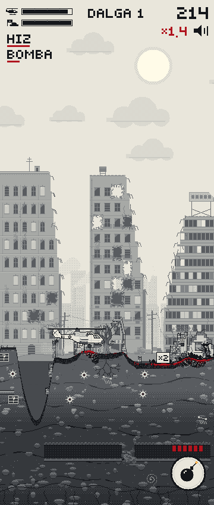

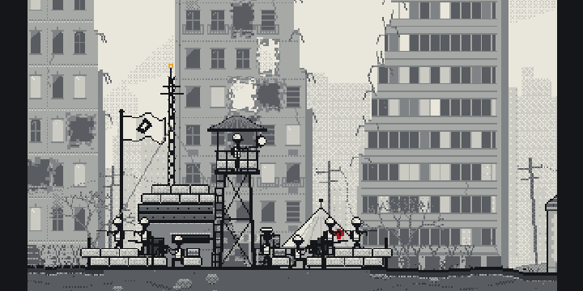

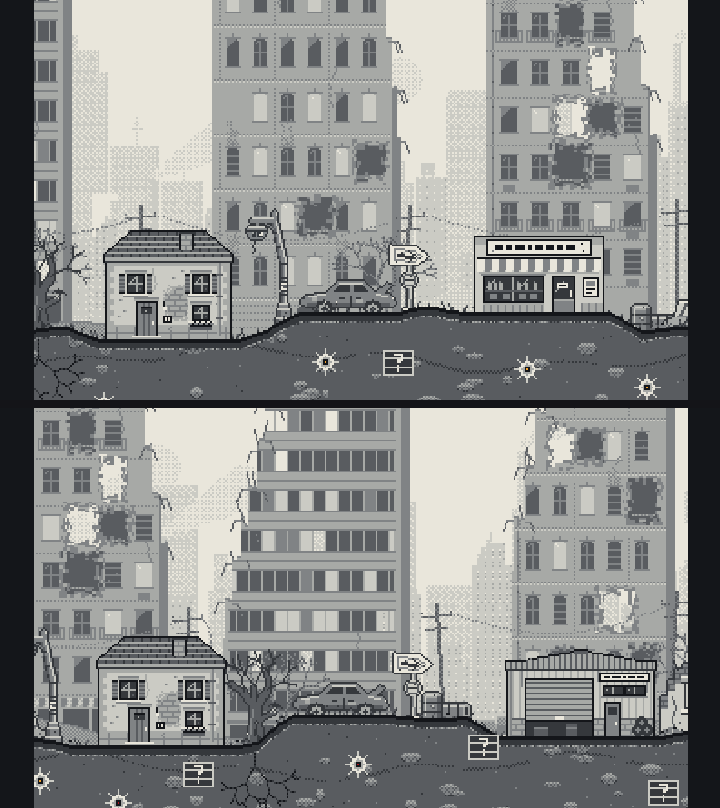

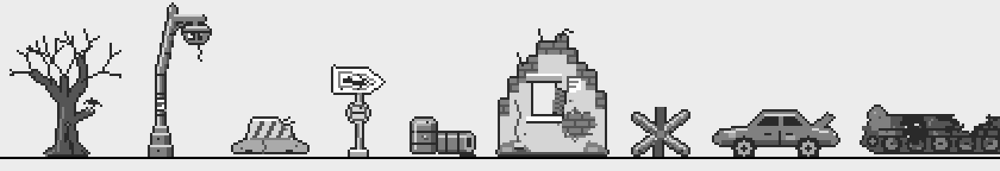

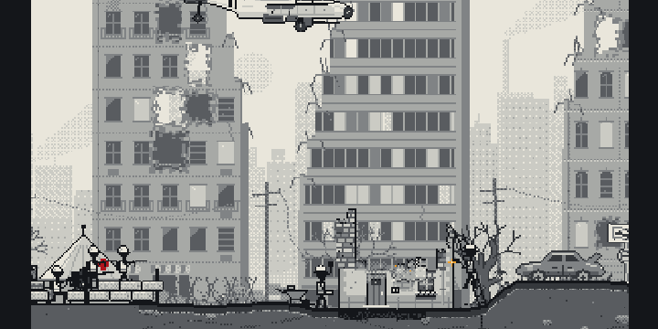

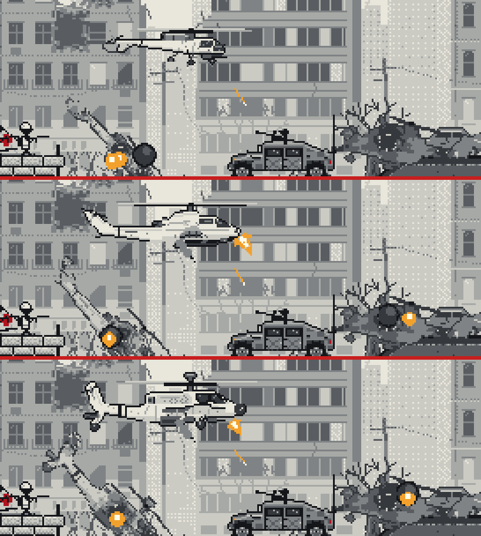

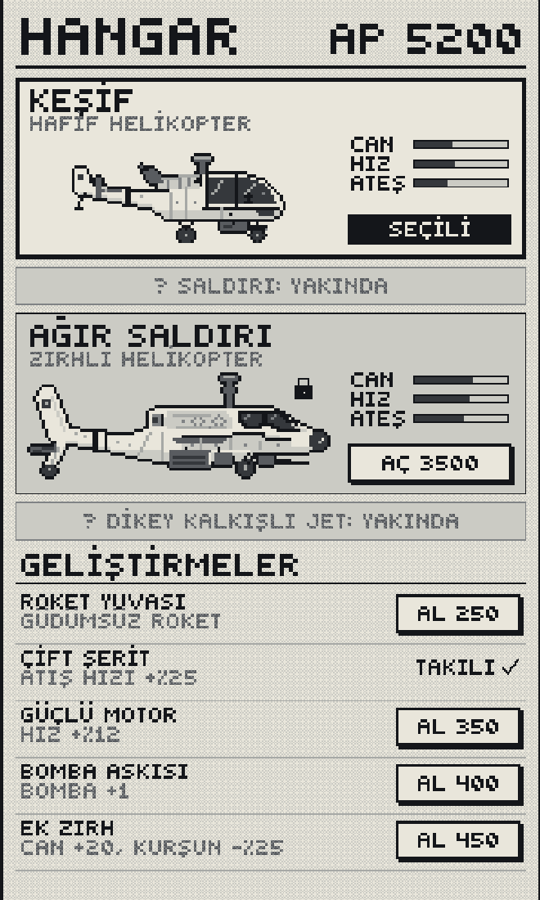

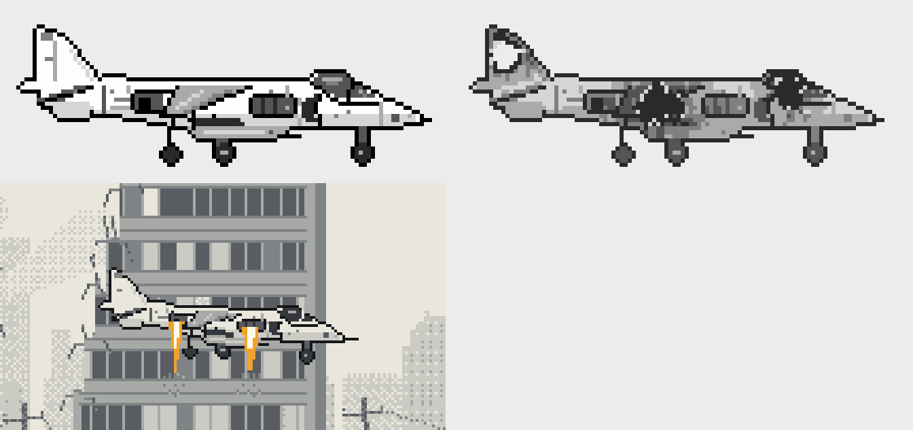

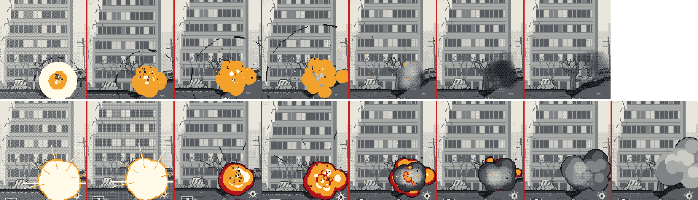

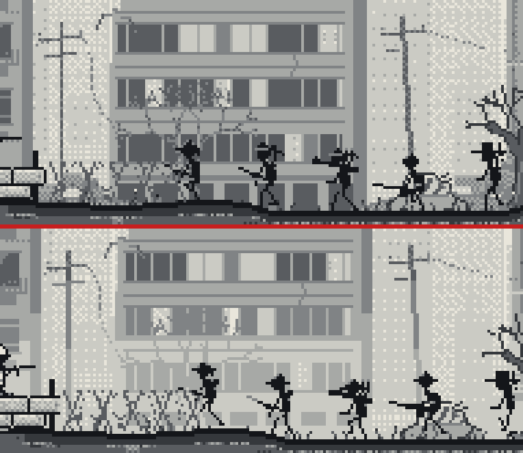

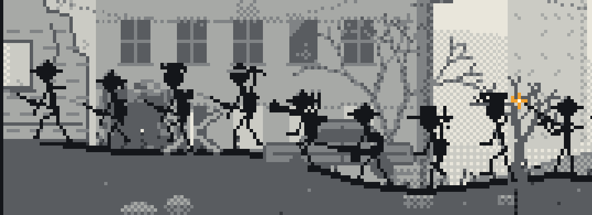

## Nasıl oynanır

- **İki cephe:** siper ortada, düşman iki yandan gelir. Ekran kenarındaki ok
  ve sayı öbür cepheden gelenleri gösterir; kırmızı yanıp sönüyorsa sipere
  dayanmışlardır. Oka dokun: helikopter o cepheye kendisi uçar.
- **Hangar:** hafif bir keşif helikopteriyle başlarsın. Oynadıkça araştırma
  puanı (AP) birikir; roket yuvası, zırh, füzeler ve daha güçlü helikopter
  AP ile açılır. Hattın sonunda dikey kalkışlı jet var: hızlı, ince zırhlı,
  bol bombalı; salkım bomba yalnız onda.
- **Sürükle:** helikopter parmağını izler (göreli; parmağın altında kalmaz).
- **Silahlar kendi ateş eder:** top en yakın hedefe, roketler araçlara ve
  kalabalık piyadeye. Yaklaştıkça top daha isabetli.
- **Bomba elle:** yalnız sağ alttaki düğmeyle. 3 bomba var, zamanla dolar.
- **Toprağı kaz:** kesitte görünen `?` kutularının üstünü bombayla aç,
  sandık fırlar; üstüne gel, helikopter halatla çeker (çift top, hız,
  bomba yağmuru). Dikenli
  toplar mayın: üstü açılınca patlar, üstündekileri götürür.
- **Amaç:** soldaki siperi dalga dalga gelen düşmana karşı korumak.
  Helikopter düşerse ya da siper düşerse oyun biter.
- **Çukur ve köprü:** aynı yeri üst üste bombalarsan araçlar geçemez,
  kenarda bekler. Köprücü zırhlı gelip köprü kurar; köprüyü üstündekilerle
  birlikte çökertebilirsin.
- **Binalar:** savaş alanındaki küçük evlerin içinden ateş edilir; bomba ve
  roketle tuğla tuğla yıkılır.
- Kırmızı kesik çizgi = tank sana nişan aldı; daralan halka = uçaksavar
  atışı geliyor; `< UÇAK` = bombardıman uçağı o yükseklikten geçecek.
- Dalga bitince hasarın varsa dost uçak paraşütle tamir sandığı atar.

Klavye: oklar / WASD, boşluk ya da `B` bomba, `M` ses.

## Çalıştırma

```powershell
npm ci
npm run dev            # http://localhost:5173
npm test
npm run typecheck
npm run build:single   # → barut.html (çift tıkla açılır) + dist-single/artifact.html
```

Görüntü ve kayıt (dev sunucusu açıkken):

```powershell
node scripts/shot.mjs http://localhost:5173/ kare.png 390 844 "L.basla(); L.ilerlet(5)"
node scripts/kayit.mjs http://localhost:5173/ kareler 30 16 20   # bot pilotla oynatır, kare kaydeder
```
