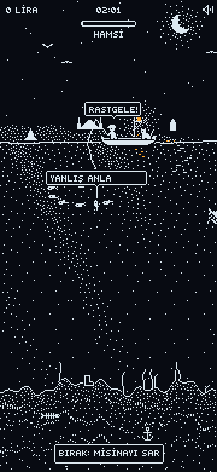

# LODOS — gece balıkçısı

1-bit piksel sanatlı, ip fizikli balık tutma oyunu. Boğaz'da bir takka, bir
reis, bir de kedi. Gece 02:00'de başlar; yağmur gelir, lodos patlar, şafakta
biter (bir gece ≈ 2 dk 45 sn).



## Nasıl oynanır

- **Basılı tut:** tekne parmağına gelir, misina parmağına kadar iner.
- **Bırak:** misina sarılır; kancadaki balık tekneye gelir.
- **Zincir:** tuttuğunu çekmeyip derine indir; daha büyüğü onu yutup kancaya
  takılır. Hamsi → istavrit → palamut → lüfer → kılıç. Büyükler sağda, derinde.
- **Çırpınırken çekme:** büyük balık çırpınırken sararsan misina kopar.
  Parmağını balığın üstüne koyup bekle, durulunca çek.
- Denizanasına değme; kedi arada bir hamsini yer.

Klavye: oklar / WASD (aşağı = misinayı sal), `M` ses.

## Çalıştırma

```powershell
npm ci
npm run dev            # http://localhost:5173
npm test
npm run typecheck
npm run build:single   # → lodos.html (çift tıkla açılır) + dist-single/artifact.html
```

Görüntü ve kayıt (dev sunucusu açıkken):

```powershell
node scripts/shot.mjs http://localhost:5173/ kare.png 390 844 "L.basla(); L.ilerlet(5)"
node scripts/kayit.mjs http://localhost:5173/ kareler 0 20 20   # botla oynatır, kare kaydeder
```
